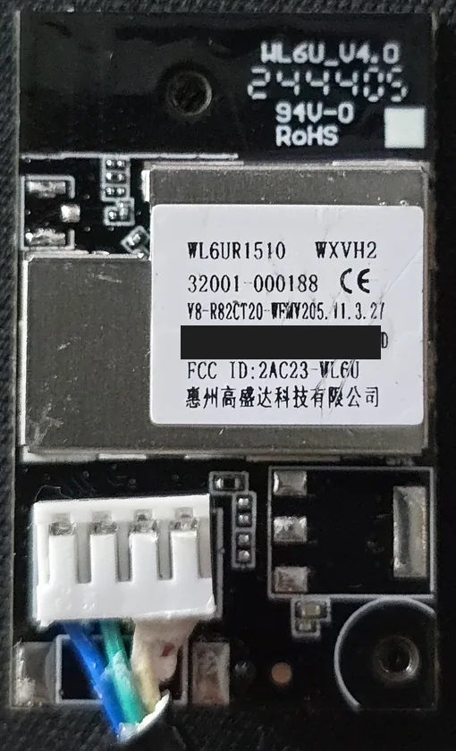
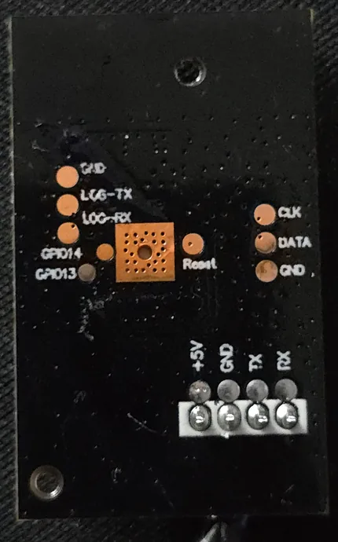

# TCL AC Original Module ESPHome

The goal was local Home Assistant control without the TCL cloud. The ESPHome projects checked during research all replaced the original Wi-Fi module with an ESP32.

That seemed like a waste of a perfectly working chip. The original WL6U module already has a Realtek RTL8720CF that LibreTiny supports, so why not run ESPHome on that instead?

That's what this project does. It keeps the original module and replaces its firmware, so there's no replacement board to buy or fit inside the AC.

**Tested on one TAC-12CHSD so far.** Other models and revisions haven't been verified. Still experimental: reports from other TCL units are welcome (see [Help test other AC models](#help-test-other-ac-models)).

## What you get

Everything runs locally over the ESPHome API; no TCL account or cloud.

### Everyday control

- **Climate:** off, auto, cool, dry, fan and heat; 16–31 °C in 0.5 °C steps.
- Fan speed, swing, louver position, Eco/Boost/Sleep presets.
- Display, beep, health, anti-mould, 3D airflow and light-sense switches.
- A module **Restart** button.

### Data straight from the AC, not just what TCL's app shows

The module reads the AC's own status and energy replies directly, so you get the data itself rather than the vendor app's selection of it:

- **Room temperature to 0.1 °C.** The stock firmware truncates it to whole degrees before reporting; this keeps the tenths already in the AC's reply.
- **Live power (W) and cumulative energy (kWh)** from the AC's own energy counter. Track running cost per day or per cycle in Home Assistant's Energy dashboard.
- **Compressor frequency (Hz):** see when the compressor is actually running and how hard, not just the mode you selected.
- **Outdoor temperature** (estimated).
- **Supply voltage** as reported by the AC.
- **Numeric error codes** exactly as the AC reports them, plus a **filter-blocked** flag (disabled by default). Alert on a fault the moment it appears.
- **Raw internal readings** (disabled by default): indoor and outdoor coil, compressor discharge, indoor and outdoor fan, and a load index.
- **AC link:** a heartbeat showing the AC is still answering, even when nothing changes.
- **Raw UART receive logs** of every byte the AC sends, including the ones nobody has decoded yet.

Labels marked *inferred*, *estimated* or *raw* are not verified measurements: compressor-frequency and supply-voltage labels are inferred from the stock code, the outdoor conversion is provisional, and the raw readings are tentatively labelled bytes. Physical louver labels have not been verified. A delivered API call or TX log does not prove the AC accepted a command. See [controls and limitations](docs/CONTROLS.md) for entity behavior, optional features and API actions, and [getting past the app's view](docs/REVERSE_ENGINEERING.md#getting-past-the-apps-view-of-the-ac) for what is decoded.

## Is this for you?

**Hardware:** the original **WL6U_V4.0** Wi-Fi module (label `WL6UR1510`, RTL8720CF, 2 MiB flash) in a TCL air conditioner. Other Wi-Fi module hardware is not supported.

 

*WL6U_V4.0, front and back. Serial number redacted; photo metadata removed.*

The AC connection uses PA11 for TX and PA12 for RX at 9600 baud, 8E1. Programming and logs use the separate LOG pads with 3.3 V logic.

**Skills for the first installation (once):** removing the module from the AC, connecting a 3.3 V USB–UART adapter and a 5 V supply to its programming pads, and following a step-by-step guide on a Linux command line. You make and keep a full backup of the original firmware before writing anything.

**After that:** updates go over Wi-Fi, from ESPHome Device Builder or the command line. You don't need to open the AC again.

> [!WARNING]
> **Disconnect AC mains before removing or installing the module.** Do all programming with the module completely disconnected from the appliance. Never attach USB or bench power to a module connected to the AC; low-voltage labels do not establish mains isolation.

## Install

### 1. First installation (serial, once)

Follow the **[flashing guide](docs/FLASHING.md)**, and read **[recovery](docs/RECOVERY.md)** before the first write.

The first installation is a deliberate bootloader/flash-layout migration from a verified backup. **Do not upload a generic ESPHome application over the stock firmware.** The stock firmware version doesn't need to match the analyzed dump; the preparation helper checks the flash layout and backup integrity instead. Full restoration of stock operation has not yet been tested.

See the [annotated flashing-pad photo and wiring table](docs/FLASHING.md#2-wire-it-with-all-power-off) for programmer connections.

### 2. Add it to Home Assistant

Add the **ESPHome** integration with the module's address and API encryption key. Check that **AC link** is on and the readings match the AC before sending commands.

If the module cannot join Wi-Fi for one minute, it opens a **WL6U Recovery** hotspot (password: your `recovery_ap_password`). Join it and open `http://192.168.4.1/` to enter new network credentials. See [Wi-Fi recovery](docs/RECOVERY.md#wi-fi-recovery-hotspot).

### 3. Later updates over Wi-Fi

**ESPHome Device Builder:** copy [`firmware/device-builder.yaml`](firmware/device-builder.yaml) into Device Builder as `tcl-wl6u-ac.yaml`, then **Install → Wirelessly**. ESPHome fetches the configuration and the `tcl_ac` component from this repository. Device Builder's secrets must hold the **same** Wi-Fi, API key, OTA password and recovery-hotspot values used for the first installation (see [`secrets.example.yaml`](firmware/secrets.example.yaml)); a different OTA password or API key will not match the running firmware.

**Command line,** from a checkout of this repository:

```sh
esphome run firmware/tac-12chsd.yaml --device YOUR_DEVICE_IP
```

More detail, including OTA password handling, is in [later updates over Wi-Fi](docs/FLASHING.md#later-updates-over-wi-fi).

## Choosing a profile

- **[`tac-12chsd.yaml`](firmware/tac-12chsd.yaml)** (default): tailored to the tested TAC-12CHSD. Everyday controls are enabled, optional diagnostics are disabled by default, and unsupported/extended entities are omitted.
- **[`all-fields.yaml`](firmware/all-fields.yaml):** for testing other models. Exposes every currently implemented entity, including other-model/extended fields, raw outdoor temperature and module-health sensors (uptime, Wi-Fi signal, heap, loop time, reset reason). Optional entities are disabled by default; you choose which to enable in HA. It does **not** detect compatibility or decode every unknown byte.

In Device Builder, switch profile by changing the extras file named in `device-builder.yaml`. Both profiles include the shared controls, password-protected OTA and the Wi-Fi recovery hotspot, and use the same node name (`tcl-wl6u-ac`), so switching keeps your Home Assistant device. See [profile selection](docs/CONTROLS.md#firmware-profiles) before enabling unfamiliar controls.

## Using it in Home Assistant

**AC link is the AC-side heartbeat.** It stays on while validated AC status replies are fresh and turns off if no valid status has arrived for more than 10 seconds. Use it to check that the AC is still answering even when temperatures and settings stay the same. Home Assistant's device availability separately shows whether the module itself is reachable.

Entity states are sent to Home Assistant **only when their values change**, rather than repeating identical readings over Wi-Fi. UART polling and local sampling continue at their normal intervals, including while the AC is off; real changes are reported at the next sample. Connecting API clients still receive an initial state snapshot.

- An unchanged entity's HA update timestamp can look old even though it is still being sampled; check AC link and device availability instead.
- If deriving energy from the Power sensor with HA's [Integral helper](https://www.home-assistant.io/integrations/integration/), configure `max_sub_interval` for regular accumulation during constant power. The AC's own Energy sensor does not need this.

Ready-made automations for [error-code alerts](docs/CONTROLS.md#alerting-on-error-codes) and [automatic reboot when the AC link wedges](docs/RECOVERY.md#automatic-reboot-when-the-ac-link-wedges) are in the docs.

## Known issues and workarounds

### Wi-Fi: WPA2 is forced

Use **WPA2-Personal or a WPA2/WPA3 mixed** Wi-Fi network. WPA3-only networks are not supported.

On the tested module and ASUS router, WPA3 connections repeatedly dropped at the same minute and second each hour, making the device unavailable in Home Assistant despite strong signal. The timing suggests a compatibility problem during hourly group-key renewal, but the exact cause has not been proven.

As a targeted workaround, an early boot hook in [`bench.yaml`](firmware/bench.yaml) calls `wifi_set_wpa_mode(WPA2_ONLY_MODE)` before Wi-Fi starts. This restricts the module to WPA2 without changing the router's security settings or the network credentials. Protected management frames (PMF) are not disabled, and the router's normal group-key renewal remains enabled. With WPA2 (AES), the AC link stayed continuously online for more than 60 hours across the previously failing hourly boundary.

### UART: LibreTiny serial receive race

LibreTiny's serial driver updates its receive-buffer count from both the main loop and the receive interrupt without protection. When they collide, every later frame from the AC is read shifted (5 bytes on the tested unit) and the AC link stays down until a reboot. This firmware wraps the serial read in a FreeRTOS critical section, the same fix as upstream [LibreTiny PR #432](https://github.com/libretiny-eu/libretiny/pull/432) ([issue #419](https://github.com/libretiny-eu/libretiny/issues/419)). The wrap will be removed once a LibreTiny release includes that fix. Details: [LibreTiny serial receive patch](docs/CONTROLS.md#libretiny-serial-receive-patch).

## Help test other AC models

Reports from other TCL models are the fastest way to make this work for more people. To check yours:

1. Install with the [`all-fields`](#choosing-a-profile) profile.
2. In Home Assistant, enable the **Status payload length** and **AC type code** diagnostic entities (disabled by default) and note their values.
3. Test **one control at a time** from Home Assistant and compare with the AC's own display and behavior. A setting that shows up in Home Assistant is not proof the AC applied it. Note any side effects.
4. Capture a short **network** log (not USB) around one action: Device Builder's **Logs → Wirelessly**, or `esphome logs firmware/all-fields.yaml --device YOUR_DEVICE_IP`. Lines starting `AC <<<` are what the AC sent.
5. [Open an issue](https://github.com/kralonur/tcl-ac-original-module-esphome/issues/new) with the AC model (from the nameplate), the module label and revision, the two diagnostic values, what works and what doesn't, and the log excerpt.

**Before sharing, redact Wi-Fi names, IP/MAC addresses and serial numbers.** Never share secrets, your stock backup (it contains device credentials) or compiled firmware.

## Development

Keep fixes focused and include the checks run in your pull request. Compatibility reports should name the exact AC/module revision and distinguish observed behavior from inference. Keep API/OTA access on a trusted network; do not disclose sensitive findings in public issues.

Set up the build environment from this repository's root (Linux, Python 3.14):

```sh
python3.14 -m venv .venv-firmware
. .venv-firmware/bin/activate
python -m pip install -r requirements-firmware.txt
```

Create `firmware/secrets.yaml` from [the example](firmware/secrets.example.yaml), without overwriting an existing file. For compile-only checks, use synthetic Wi-Fi values. Builds embed credentials: keep secrets, binaries and build directories private.

Offline checks, from the repository root:

```sh
# Profile regression: entity selection, shared-entity equality, dedup, WPA2 hook,
# Device Builder configuration.
python -m unittest discover -s tests -v

# Stock-faithful codec logic against fixed expectations (no ESPHome needed).
g++ -std=c++17 -Wall -Wextra -pedantic -Ifirmware/components/tcl_ac \
    firmware/test_codec.cpp -o /tmp/tcl-codec-test && /tmp/tcl-codec-test

# Both control profiles must compile for the real RTL8720CF target.
esphome compile firmware/tac-12chsd.yaml
esphome compile firmware/all-fields.yaml

# Host build of the real component against actual ESPHome entities, with an
# in-memory UART: status gating, queued/direct writes, float32 targetElectric
# restore, timer deferral, queueing and expiry, energy-derived power. Takes ~30 s.
esphome compile tests/component.yaml
tests/.esphome/build/tcl-ac-component-test/.pioenvs/tcl-ac-component-test/program
```

These are offline checks, not hardware compatibility tests or uploads.

Other targets: `firmware/bench.yaml` only enables Wi-Fi, the API and the LOG UART (no AC UART or OTA). `firmware/ac-debug.yaml` adds status polling and raw AC logs, but no controls or OTA. `firmware/loopback.yaml` is a transmitting connector diagnostic: **never connect it to the AC.**

## How the original firmware was decoded

Started with a flash dump read directly from the original module. Reverse-engineered the stock code that builds commands for the AC and decodes its replies, not phone-app traffic. Checked selected functions in an emulator, then tested the replacement firmware on the AC.

That included the control table, status fields, temperature calculations, error bits, energy data and timer formats. The temperature decoding comes from the original firmware's calculations, not a guessed offset. Home Assistant also keeps the tenths of a degree present in the room-temperature data instead of dropping them like the stock report does.

The goal is access to what the AC actually sends, not just the settings and readings TCL chooses to show in its Wi-Fi app. Not every byte has a known meaning, and features found in the stock code aren't necessarily supported by the tested AC.

The [reverse-engineering notes](docs/REVERSE_ENGINEERING.md) cover the findings, exact temperature formulas and remaining unknowns. The stock dump and device credentials aren't included here.

## Layout

- `firmware/`: ESPHome configurations; the `tcl_ac` external component (protocol codecs, climate platform) is self-contained in `firmware/components/tcl_ac/`.
- `tools/`: offline installation preparation and explicit live API helper.
- `docs/`: flashing, recovery, control and reverse-engineering reference.

## License

This project's original code and documentation are dual-licensed under either [MIT](LICENSE-MIT) or [Apache-2.0](LICENSE-APACHE), at your option (`MIT OR Apache-2.0`). Unless stated otherwise, contributions are accepted under the same terms. Third-party material, including dependencies, is subject to its own terms. No vendor firmware, private backups or vendor documents are distributed here.
